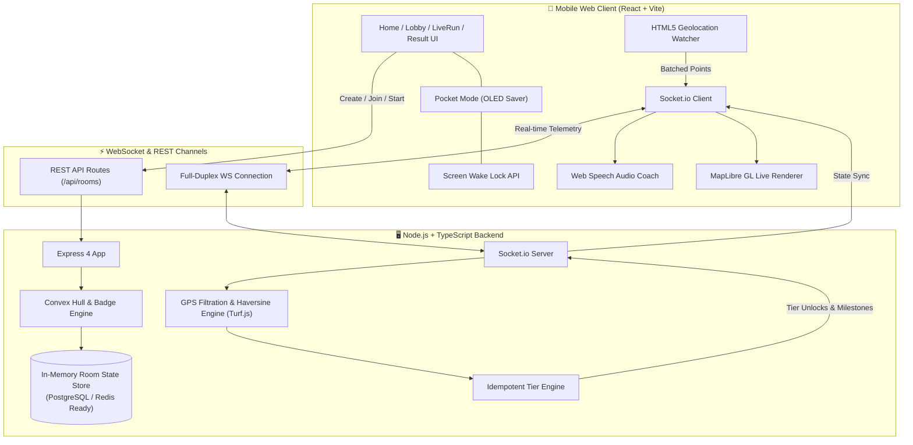
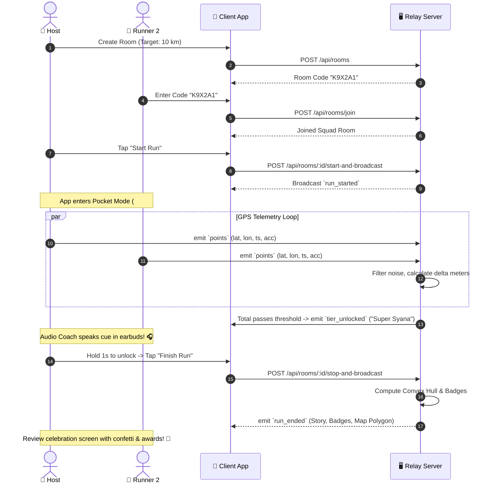

<div align="center">

# 🏃‍♂️⚡ TOUCH GRASS RELAY (RUN)

### *Pocket Your Phone. Run with Friends. Reach God Mode.*

A mobile-first, collaborative running web application designed so your phone stays inside your pocket the entire time. Distance is pooled in real-time across your squad to unlock collective anime power transformations, coached hands-free through your earbuds.

[](https://react.dev/)
[](https://www.typescriptlang.org/)
[](https://nodejs.org/)
[](https://socket.io/)
[](https://tailwindcss.com/)
[](https://maplibre.org/)
[](LICENSE)

[Architecture](#-system-architecture) • [Features](#-core-features) • [Workflow](#-user-workflow) • [Use Cases](#-use-cases) • [How to Run](#-getting-started) • [Tech Stack](#-tech-stack)

---

</div>

## 📖 Overview

Most fitness and tracking apps demand your eyes: flashing rings, complex pace charts, and turn-by-turn prompts that force you to look down at your screen while running through nature.

**Touch Grass Relay** flips this dynamic inside-out:
- **Zero Screen Glancing:** Put on your headphones, start the relay, lock into **Pocket Mode**, and slide the phone into your pocket.
- **Shared Anime Transformations:** Runners in the same room pool their distances in real-time. Hit collective distance milestones to ascend from *Base Form* all the way to *God Mode*.
- **Audio Coaching:** Real-time milestone announcements, squad updates, and tier unlocks are whispered directly into your earbuds via the Web Speech API.
- **Zero App Stores & Zero Paywalls:** 100% web-based. Create an ephemeral squad room, share a 6-character code or QR, and join within 3 seconds on any smartphone browser.

---

## ⚡ Core Features

### 1. 📴 Pocket Mode (OLED Power Saver)
- **Pure AMOLED Black (`#000000`):** Minimizes display power draw on modern OLED screens down to near zero.
- **Screen Wake Lock API:** Prevents mobile operating systems from freezing background GPS timers and WebSockets when in your pocket.
- **Hold-to-Unlock Protection:** 1-second long-press gesture prevents accidental leg touches or fabric friction from interrupting your run.

### 2. 🧬 Real-Time Anime Power Levels
Collective distance unlocks shared transformations with adaptive scaling based on group size:
| Tier | Theme Color | Unlock Voice Cue |
| :--- | :---: | :--- |
| **Awakened** | `#00BFFF` (Cyan) | *"Power rising. {km} km combined. You are Awakened."* |
| **Kaioken** | `#FF4500` (Crimson) | *"Kaioken! {km} km down. Limits broken."* |
| **Super Syana** | `#FFD700` (Gold) | *"Aura on. {km} km. Super Syana!"* |
| **Syana 2** | `#7B68EE` (Violet) | *"Lightning crackles. {km} km. Syana 2."* |
| **God Mode** | `#FF1493` (Neon Pink)| *"Final form. {km} km. God Mode unlocked."* |

> 💡 **Squad Adaptive Scaling:** Thresholds dynamically calibrate depending on group size (1 runner, 2 runners, or full squads) so solo runners and squads alike can hit achievable peak tiers.

### 3. 🛡️ Multi-Stage Anti-Cheat & GPS Filter Pipeline
Raw GPS data from mobile phones is notoriously noisy. Every coordinate batch is sanitized through a 5-step validation gate:
1. **Accuracy Filter:** Drops any reading with an uncertainty radius `> 25m`.
2. **Speed Gate:** Filters out unrealistic speeds `> 25 km/h` (rejects driving / cycling cheating).
3. **Drift Gate:** Drops stationary jitter `< 3m`.
4. **Teleport Gate:** Blocks sudden position jumps `> 500m`.
5. **Rate Limiter:** Ensures clean point spacing (minimum 3 seconds between points).

### 4. 🗺️ 100% Free & Open Mapping
- Built with **MapLibre GL JS** and OpenStreetMap tiles.
- Zero proprietary map API limits, credit cards, or tracking cookies.
- Live runner avatars, breadcrumb trails, and collective coverage rendering.

### 5. 📜 Post-Run Battle Chronicles & Badges
- **Convex Hull Coverage:** Computes the collective geographic territory conquered by the squad in km² using Turf.js.
- **Narrative Battle Story:** Generates an engaging summary recap of the squad's journey.
- **Achievement Badges:** Automatically awards accolades including *Top Contributor*, *First Blood*, *Iron Will*, and *Explorer*.

---

## 🏛 System Architecture



### Event Matrix

| Direction | Event Name | Payload Description |
| :--- | :--- | :--- |
| **Client ➔ Server** | `points` | Batch of validated GPS records `{ batch: [{ lat, lon, ts, acc }] }` |
| **Server ➔ Client** | `state` | Real-time room metrics, total combined km, active tier, runner positions |
| **Server ➔ Client** | `tier_unlocked` | Newly breached tier, hex aura color, custom audio voice line |
| **Server ➔ Client** | `run_started` | Host signal triggering pocket mode & GPS streaming |
| **Server ➔ Client** | `run_ended` | Final stats, Turf.js convex hull polygon, battle narrative, badges |

---

## 🔄 User Workflow



---

## 🎯 Use Cases

- **🏃‍♂️ Social Run Clubs:** Break local runners into squads where everyone's effort counts equally toward unlocking God Mode.
- **🌍 Remote / Distributed Relays:** Run simultaneously with friends in different cities or timezones in the same virtual room.
- **🌲 Mindful Trail Running:** Enjoy nature with zero screen-checking, guided purely by audio announcements.
- **🔥 Gamified Fitness Challenges:** Transform routine jogs into cooperative anime-inspired raid bosses.

---

## 🛠 Tech Stack

### Frontend (Client)
- **Framework:** [React 18](https://react.dev/) + [Vite](https://vitejs.dev/)
- **Styling:** [Tailwind CSS 3](https://tailwindcss.com/) + Custom Teko Display Typography
- **Real-Time Client:** [Socket.io Client](https://socket.io/)
- **Mapping:** [MapLibre GL JS](https://maplibre.org/) with OpenStreetMap vector tiles
- **Audio & Cues:** HTML5 Web Speech API (`SpeechSynthesisUtterance`)
- **Battery & Display:** W3C Screen Wake Lock API
- **Icons & FX:** [Lucide Icons](https://lucide.dev/), [Canvas Confetti](https://www.npmjs.com/package/canvas-confetti)

### Backend (Server)
- **Runtime:** [Node.js 18+](https://nodejs.org/) with [TypeScript 5.8](https://www.typescriptlang.org/)
- **Server Framework:** [Express 4](https://expressjs.com/)
- **Real-Time Engine:** [Socket.io 4.8](https://socket.io/)
- **Geospatial Math:** [@turf/turf](https://turfjs.org/) (Haversine distance, convex hull polygon computation)
- **Data Validation:** [Zod](https://zod.dev/) (Strict GPS schema enforcement)
- **Execution:** [tsx](https://github.com/privatenumber/tsx) (Zero-build TypeScript watch runner)
- **Database / Cache (Optional):** PostgreSQL (`pg`) & Redis (`ioredis`) adapters included

---

## 📁 Repository Structure

```
RUN/
├── 📄 DEV_POST_SUBMISSION.md   # Hackathon submission write-up
├── 📄 README.md                # Project documentation
├── 📁 client/                  # Mobile Web Application (PWA)
│   ├── 📄 index.html           # Single Page App entry point
│   ├── 📄 package.json         # Client dependencies & scripts
│   ├── 📄 tailwind.config.js   # Custom anime themes & color tokens
│   ├── 📄 vite.config.js       # Vite development configuration
│   └── 📁 src/
│       ├── 📄 App.jsx          # Routing & screen orchestrator
│       ├── 📄 index.css        # Global styles & font imports
│       ├── 📁 components/
│       │   ├── 📄 Map.jsx          # MapLibre GL runner visualization
│       │   ├── 📄 PocketMode.jsx   # OLED dark mode & Wake Lock
│       │   └── 📄 TierBanner.jsx   # Anime transformation banner
│       ├── 📁 pages/
│       │   ├── 📄 Home.jsx         # Squad creation / Room code entry
│       │   ├── 📄 Lobby.jsx        # Room lobby & member roster
│       │   ├── 📄 LiveRun.jsx      # Active relay dashboard
│       │   └── 📄 Result.jsx       # Post-run awards & battle story
│       └── 📁 utils/
│           └── 📄 voice.js         # Web Speech audio coach
└── 📁 server/                  # Real-Time Relay Server
    ├── 📄 package.json         # Server dependencies & scripts
    ├── 📄 tsconfig.json        # TypeScript configuration
    ├── 📁 scripts/
    │   └── 📄 fake-gps.ts      # Multi-runner GPS simulator
    └── 📁 src/
        ├── 📄 config.ts        # Environment & filter parameters
        ├── 📄 index.ts         # Express & Socket.io server bootstrap
        ├── 📄 types.ts         # Shared TypeScript interfaces & Zod schemas
        ├── 📁 db/              # Optional PostgreSQL & Redis pools
        ├── 📁 routes/          # REST endpoints & WS handlers
        └── 📁 services/
            ├── 📄 gps-service.ts    # 5-stage filter & turf distance math
            ├── 📄 room-service.ts   # In-memory squad room lifecycle
            ├── 📄 tier-engine.ts    # Milestone calculation & trigger logic
            └── 📄 result-service.ts # Badge & narrative story generator
```

---

## 🚀 Getting Started

### Prerequisites
- **Node.js** v18.0.0 or higher
- **npm** (included with Node.js)

---

### 1. Clone & Configure

```bash
git clone https://github.com/danishjk2156/Run.git
cd Run
```

#### Setup Environment Variables

```bash
# Server configuration
cp server/.env.example server/.env

# Client configuration
cp client/.env.example client/.env
```

*(Defaults work immediately out of the box with zero external services required!)*

---

### 2. Start the Backend Server

```bash
cd server
npm install
npm run dev
```

The server will start listening on `http://localhost:3001` (WebSocket at `ws://localhost:3001`).

---

### 3. Start the Frontend Client

In a separate terminal:

```bash
cd client
npm install
npm run dev
```

Vite will serve the client at `http://localhost:5173`.

> 📲 **Running on Real Mobile Phones (Over Local Wi-Fi):**
> Vite runs with `--host` enabled. Find your computer's local IP address (`ipconfig` on Windows or `ifconfig` on macOS/Linux), e.g., `192.168.1.15`.
> Open `http://192.168.1.15:5173` on any phone connected to the same Wi-Fi network!

---

### 4. Test Without Going Outside (GPS Simulator)

Want to see all tiers, maps, and audio cues unlock right from your desk? Run the included **multi-runner GPS simulator**:

```bash
# In server/ directory
npm run fake-gps
```

This script:
1. Automatically creates a test squad room.
2. Connects 4 simulated runners (*Goku, Vegeta, Piccolo, Gohan*).
3. Streams realistic walking/running GPS coordinates through the WebSocket pipeline.
4. Unlocks anime tiers incrementally until the run concludes!

---

## 📜 License

This project is open source and available under the [MIT License](LICENSE).
